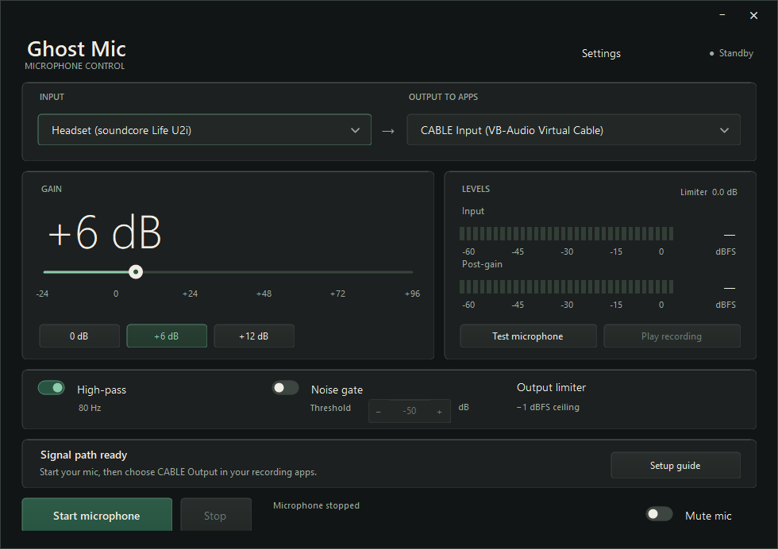

# Ghost Mic

A local Windows microphone controller with digital gain, live monitoring, and virtual microphone routing for Discord, Snipping Tool, and other recording apps. Native desktop UI; audio processing stays on your PC.

Companion project: [Ghost](https://github.com/Cryosimorgh/Ghost), the chat application. Ghost Mic is a separate application and does not require Ghost to run.

An [Android version](android/README.md) is also available: [download the APK](https://github.com/Cryosimorgh/ghost-mic/releases/download/android-v1.0.0/GhostMic-android.apk). It focuses on input-device selection, offline RNNoise denoising, recording, and live monitoring. Stock Android does not expose it as a virtual microphone to other apps. Android downloads are published separately from the Windows release.

## Download

Download [GhostMic-win-x64.zip](https://github.com/Cryosimorgh/ghost-mic/releases/latest/download/GhostMic-win-x64.zip) from the [latest release](https://github.com/Cryosimorgh/ghost-mic/releases/latest), extract it to a writable folder, and open `GhostMic.exe`. Requires Windows 10/11 x64 and [.NET Desktop Runtime 10 x64](https://dotnet.microsoft.com/en-us/download/dotnet/10.0). The virtual microphone endpoint requires the separate VB-CABLE driver described below.

Keep the executable and all accompanying DLL/configuration files together. For a source build, the runnable folder is `dist/`.

## First use

1. Open `dist/GhostMic.exe`. Select your physical microphone.
2. Choose **Settings → Install virtual device** to download and open the official signed VB-CABLE driver installer. Approve Windows UAC, click Install Driver, and reboot as instructed by VB-Audio. This is a separate third-party donationware driver; Ghost Mic does not contain a custom kernel driver. See https://vb-audio.com/Cable/ for licensing, download, and manual installation.
3. Reopen Ghost Mic and click **Settings → Refresh devices**. Set its destination to **CABLE Input (VB-Audio Virtual Cable)**, then click **Start microphone**.
4. Discord → User Settings → Voice & Video → Input Device: **CABLE Output**. Disable automatic gain control to avoid competing volume adjustments. Noise suppression is your choice. Adjust input sensitivity if quiet speech is cut off.
5. Snipping Tool → screen recording → microphone menu: select **CABLE Output** and enable microphone recording. **Settings → Use as Windows default microphone** sets the matching cable capture device as Windows' default input and communications mic. Apps using their default microphone will follow this; explicitly selected physical microphones must be changed in those apps. **Restore previous default microphone** restores the input defaults saved before the first change. Windows playback defaults are left alone.

The cable names are intentionally reversed from a microphone's perspective: Ghost Mic plays into CABLE **Input**, and recording apps capture CABLE **Output**. Keep your normal headphones/speakers as the Windows playback device. Do not enable Windows “Listen to this device” on the physical mic or cable.

## Controls

- Gain: −24 to +96 dB with smooth transitions in both the main window and live test panel. A +6 dB increase roughly doubles signal amplitude; +96 dB is about 63,096 times the input amplitude before peak limiting. Existing settings above +36 dB are preserved on restart.
- Limiter: always on, −1 dBFS ceiling, immediate attack and 80 ms release. This prevents output overload; heavy limiting can sound compressed or distorted. It cannot repair clipping already present at the physical microphone.
- Rumble filter: optional 80 Hz high-pass, on by default.
- Noise gate: optional, off by default, adjustable threshold −80 to −20 dBFS, evaluated before gain. It quiets pauses and is not speech-aware noise removal. Set it below the quietest speech you want to keep.
- Mute: outputs silence while keeping the route alive.
- Input and processed peak meters, limiter reduction, input clipping warning, and output buffer recovery count.
- **Test microphone** opens the local test panel without needing a virtual device. Choose a physical playback device, switch on **Hear myself**, and click **Start test** to hear the processed mic live. Gain and mute remain adjustable during testing. Use headphones to avoid acoustic feedback; software monitoring introduces some delay. **Stop test** or closing the panel ends capture and playback. Test audio is not sent to the virtual cable.
- **Record 8s** in the test panel optionally saves a processed sample while you listen. Samples remain in `data/` beside the executable. **Play recording** in the main window opens the last recording in your Windows audio player. Continuous testing does not save audio.
- Minimize goes to the tray. **Close window to system tray** also keeps the app available when idle. Double-click its custom ghost icon to restore the window. The tray menu provides Start, Stop, Mute, Settings, and Quit. Launching the executable again restores an existing window.
- **Settings → Launch at Windows sign-in** enables a per-user startup entry. **Start in the system tray** keeps that launch hidden; **Start microphone at sign-in** starts the saved physical-mic-to-cable route. Gain and mute state are preserved. Startup waits up to about a minute for the saved devices and reports a tray warning if they remain unavailable. Manual launch does not start capture automatically.

One physical microphone is active at a time. Multichannel microphone input is averaged to mono and duplicated into stereo for cable playback. WASAPI shared mode adapts to the endpoint format; actual end-to-end latency depends on the microphone, cable, and consuming app. Capture requests 20 ms and playback 40 ms buffers; these are not a latency guarantee. Sustained output stalls discard stale audio to bound latency.

The app uses digital gain after the microphone's ADC. It raises existing noise along with your voice and cannot replace a hardware preamp's signal-to-noise improvement, phantom power, or repair clipped audio. Bluetooth hands-free microphone quality is limited by the Bluetooth profile.

## Local data and troubleshooting

`data/settings.json` stores device IDs, gain, filters, mute, and tray preferences. `data/previous-default-mic.json` stores the prior Windows input defaults when you set the cable as default. Recordings are saved only when you click Record 8s. Place the folder somewhere writable. Startup uses the current user's `Software\Microsoft\Windows\CurrentVersion\Run\GhostMic` registry value and can be disabled in Settings. Default-mic changes use Windows' IPolicyConfig COM interface, which is not a documented public API; failures are reported and partially applied changes are rolled back. Internet is used only by the explicit driver setup script.

After plugging in a different mic or disconnecting a Bluetooth headset, click Refresh devices and start again. Refresh stops the active route. Device errors stop capture and show a message. If access is denied, enable microphone access for desktop apps in Windows privacy settings. If the virtual endpoint is missing after installing the driver, reboot. If another app takes exclusive control of a device, close it or disable exclusive mode in that endpoint's advanced sound settings.

Before deleting or moving Ghost Mic, disable **Launch at Windows sign-in** and restore your previous default mic in Settings. Quit the tray app, then delete or move its folder. Re-enable startup from the new location after moving it. Driver uninstallation is managed separately by VB-Audio's installer / Windows. No service is installed.

The icon was generated with the built-in image generation tool. Source artwork: `assets/ghost-mic.png`; Windows icon: `assets/ghost-mic.ico` (16–256 px); exact prompt: `assets/icon-prompt.md`. `Make-Icon.ps1` repackages the artwork for Windows without another generation call.

Command-line integration helpers: `--configure-desktop` enables sign-in launch and saved-mic startup in the tray and sets the selected cable as default; `--disable-startup` removes the startup entry; `--desktop-status` writes verified Windows default-input and startup state to `desktop-integration-result.json`; `--startup` simulates a sign-in launch; `--tray` launches hidden without capture; `--quit` exits the running instance; `--app-status` asks it to write `data/runtime-status.json`. `--tray-test` verifies hidden launch, restore, minimize, close-to-tray and explicit Quit without capture.

## Build and verification

Requires .NET SDK 10 on Windows. `powershell -NoProfile -ExecutionPolicy Bypass -File .\build.ps1` builds, runs deterministic DSP/format tests plus native menu mouse-selection regressions, UI checks, and tray lifecycle checks, then publishes the executable. `package.ps1` builds and creates a release ZIP and SHA-256 checksum in `artifacts/`; `-SkipBuild` packages an already verified build. GitHub Actions runs the same build and checks on Windows.

NAudio 2.2.1 is pinned in the project and used under the MIT license; its notice is included as `NAudio-LICENSE.txt`. The VB-CABLE installer is downloaded only on request and is not included in the repository or release.

Diagnostic switches (run from this directory): `--self-test` writes `self-test-result.txt`; `--devices` lists active endpoints in `devices.json`; `--smoke-test` checks menu mouse selections and dismissals, renders both window sizes and the test panel, saves screenshots beside the executable, and exits without capture; `--capture-test` captures about two seconds from the built-in microphone, checks the WAV, deletes the audio, and writes only diagnostic metadata to `capture-test-result.txt`; `--monitor-test` verifies capture-to-physical-playback routing, monitoring on/off, and stop/restart while muted so the test remains silent, and writes `monitor-test-result.txt` without saving audio.
